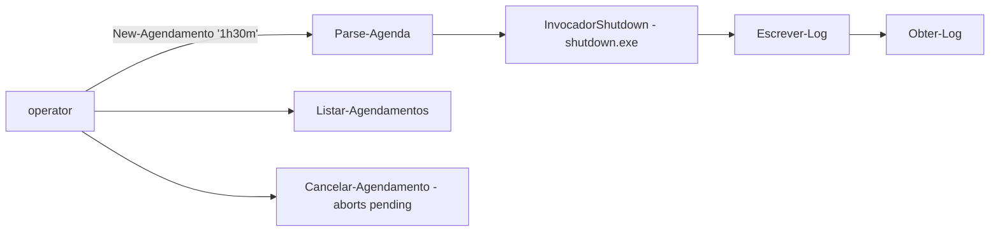

# desligamento-agendado-frota

**English** · [Português (Brasil)](README.md)

  

## What it is

**Scheduled shutdown/restart of workstations** (IT support): a **PowerShell 5.1 module** that is a safe wrapper around `shutdown.exe` (`/s`, `/r`, `/t`, `/a`). It schedules shutdowns with flexible time formats, records every scheduled action in an **execution log**, and lets you list and **cancel** pending ones. **Nothing is scheduled just by loading the module** — the shutdown invoker is a replaceable *seam* (which makes testing possible without shutting anything down).

## Status

A working IT-support tool (MVP), tested (13 Pester tests).

## Features

- **Schedule parsing** (`Parse-Agenda`): accepts plain seconds (`'120'`), minutes (`'30m'`), hours+minutes (`'1h30m'`) or absolute time (`'14:30'`); a clear error for invalid formats.
- **Schedule** (`New-Agendamento`): registers and runs the shutdown (`/s`) or restart (`/r`) with the converted time.
- **Cancel** (`Cancelar-Agendamento`): aborts the pending schedule (`/a`).
- **List** (`Listar-Agendamentos`): pending items from the log.
- **Log** (`Escrever-Log`/`Obter-Log`): every action recorded in `%TEMP%\desligamento-agendado-frota.log`.
- **Test seam**: `$script:InvocadorShutdown` is replaced in tests by a scriptblock that only records the arguments (no real shutdown).

## Architecture

A single `desligamento.ps1` file (module) + the `tests/Desligamento.Tests.ps1` suite (Pester 3.4.0). The module is dot-sourced in tests so the seam lives in the right scope.



## Stack

- Windows PowerShell 5.1 (PS7 not required)
- Pester 3.4.0 (tests) — bundled with Windows 10

## Repository layout

```
desligamento-agendado-frota/
├── desligamento.ps1              # module (cmdlets)
├── tests/Desligamento.Tests.ps1  # Pester suite
├── BRIEF.md · README.md · README.en.md
└── LICENSE                       # MIT
```

## Prerequisites and installation

Windows 10/11 with PowerShell 5.1 (default). Nothing to install; dot-source the module:

```powershell
. .\desligamento.ps1
```

## How to run

```powershell
# shut down in 1h30m
New-Agendamento -Quando '1h30m' -Acao Desligar

# restart at 14:30
New-Agendamento -Quando '14:30' -Acao Reiniciar

# list pending and cancel
Listar-Agendamentos
Cancelar-Agendamento
```

## Tests and quality

Real command (verified by the agent, Pester 3.4.0):

```powershell
Invoke-Pester -Path tests/Desligamento.Tests.ps1
# TotalCount: 13 · PassedCount: 13 · FailedCount: 0
```

The tests **do not shut anything down for real**: the shutdown invoker is intercepted by the seam.

## Technical decisions and trade-offs

- **A wrapper around shutdown.exe** instead of Windows scheduled tasks: simpler and reversible (native abort); the trade-off is that the schedule lives in the OS process, not in Task Scheduler.
- **The `InvocadorShutdown` seam**: enables testing without side effects; the module schedules nothing just by being loaded.
- **Log in `%TEMP%`**: simple action tracking; not centralised logging.

## Known limitations and roadmap

- One pending schedule per machine (native abort behaviour).
- No end-user notification before the shutdown (the native shutdown.exe shows its own warning).

## Development process

An individual project by Kelvin Oliveira, built with orchestrated AI agents and reviewed by the author.

## License and author

MIT — Copyright (c) 2026 Kelvin Rebelo de Oliveira. Author: [Kelvin Oliveira](https://github.com/KelvinOliveiraCode) · [Portfolio](https://kelvinoliveiracode.github.io/portfolio/)
