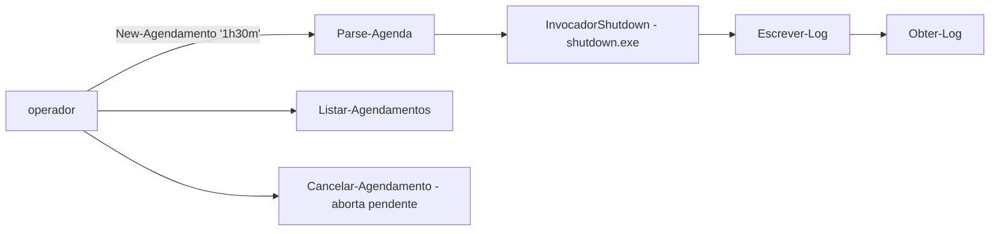

# desligamento-agendado-frota

[English](README.en.md) · **Português (Brasil)**

  

## O que é

**Desligamento/reinício agendado de estações de trabalho** (Suporte TI): um **módulo PowerShell 5.1** que é um wrapper seguro em torno do `shutdown.exe` (`/s`, `/r`, `/t`, `/a`). Agenda desligamentos com formatos flexíveis de tempo, registra cada agendamento em um **log de execução** e permite listar e **cancelar** os pendentes. **Não agenda nada ao ser carregado** — o invocador de shutdown é um *seam* substituível (o que permite testar sem desligar nada de verdade).

## Status

Ferramenta de suporte funcional (MVP), testada (13 testes Pester).

## Funcionalidades

- **Parse de agenda** (`Parse-Agenda`): aceita segundos puros (`'120'`), minutos (`'30m'`), horas+minutos (`'1h30m'`) ou horário absoluto (`'14:30'`); erro claro em formato inválido.
- **Agendar** (`New-Agendamento`): registra e executa o desligamento (`/s`) ou reinício (`/r`) com o tempo convertido.
- **Cancelar** (`Cancelar-Agendamento`): aborta o agendamento pendente (`/a`).
- **Listar** (`Listar-Agendamentos`): pendentes a partir do log.
- **Log** (`Escrever-Log`/`Obter-Log`): cada ação registrada em `%TEMP%\desligamento-agendado-frota.log`.
- **Seam de teste**: `$script:InvocadorShutdown` é substituído nos testes por um scriptblock que só grava os argumentos (nenhum desligamento real).

## Arquitetura

Arquivo único `desligamento.ps1` (módulo) + suíte `tests/Desligamento.Tests.ps1` (Pester 3.4.0). O módulo é dot-sourced nos testes para o seam ficar no escopo correto.



## Stack

- Windows PowerShell 5.1 (não precisa de PS7)
- Pester 3.4.0 (testes) — incluído no Windows 10

## Estrutura do repositório

```
desligamento-agendado-frota/
├── desligamento.ps1              # módulo (cmdlets)
├── tests/Desligamento.Tests.ps1  # suíte Pester
├── BRIEF.md · README.md · README.en.md
└── LICENSE                       # MIT
```

## Pré-requisitos e instalação

Windows 10/11 com PowerShell 5.1 (padrão). Nada a instalar; dot-source o módulo:

```powershell
. .\desligamento.ps1
```

## Como executar

```powershell
# desligar em 1h30m
New-Agendamento -Quando '1h30m' -Acao Desligar

# reiniciar às 14:30
New-Agendamento -Quando '14:30' -Acao Reiniciar

# listar pendentes e cancelar
Listar-Agendamentos
Cancelar-Agendamento
```

## Testes e qualidade

Comando real (verificado pelo agente, Pester 3.4.0):

```powershell
Invoke-Pester -Path tests/Desligamento.Tests.ps1
# TotalCount: 13 · PassedCount: 13 · FailedCount: 0
```

Os testes **não desligam nada de verdade**: o invocador de shutdown é interceptado pelo seam.

## Decisões técnicas e trade-offs

- **Wrapper em torno de shutdown.exe** em vez de tarefas agendadas do Windows: mais simples e reversível (abort nativo); em troca, o agendamento vive no processo do SO, não no Agendador de Tarefas.
- **Seam `InvocadorShutdown`**: permite testar sem efeitos colaterais; o módulo não agenda nada só por ser carregado.
- **Log em `%TEMP%`**: rastreio simples das ações; não é log centralizado.

## Limitações conhecidas e roadmap

- Um agendamento pendente por máquina (comportamento do abort nativo).
- Sem notificação ao usuário final antes do desligamento (o shutdown.exe nativo exibe aviso próprio).

## Processo de desenvolvimento

Projeto individual de Kelvin Oliveira, construído com agentes de IA orquestrados e revisado pelo autor.

## Licença e autor

MIT — Copyright (c) 2026 Kelvin Rebelo de Oliveira. Autor: [Kelvin Oliveira](https://github.com/KelvinOliveiraCode) · [Portfólio](https://kelvinoliveiracode.github.io/portfolio/)
